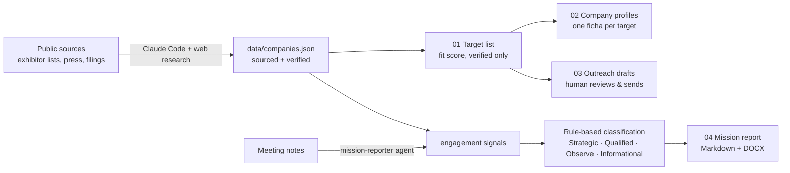

# Trade-Mission Pipeline

An AI-assisted workflow for preparing and reporting on government trade missions to international industrial fairs, developed with **Claude Code** as the working agent.

> This is a sanitized, runnable demo. All companies, people, places and figures are fictional. The production version of this workflow, used with real data in a private workspace, **supported 80+ documented B2B engagements across two international trade missions**.

## The problem

An investment-promotion office going to a fair with thousands of exhibitors has a few weeks to:

1. find which companies are actually worth meeting,
2. confirm they will be there and who decides,
3. contact them with a credible, specific pitch,
4. walk into each meeting with a one-page profile,
5. come back with a report that leadership trusts and that makes follow-up obvious.

Done by hand, this is slow and inconsistent: every report classifies outcomes differently, and unverified contacts waste meeting slots.

## The approach



| Step | What happens | Who/what does it |
|---|---|---|
| Research & verify | Builds the company universe from public sources; confirms attendance and the decision-maker | Claude Code (`.claude/skills/company-profile`) with human spot-checks |
| Score & target | Fit score (sector, expansion signal, regional link); unverified companies are excluded | `scripts/01_target_list.js` |
| Profiles | One standard ficha per target | `scripts/02_fichas.js` + `templates/ficha.md` |
| Outreach | Personalised drafts; never auto-sent | `scripts/03_outreach.js` + `templates/outreach_email_en.md` |
| Classify | Same rules every mission, unit-tested | `scripts/lib/classify.js` |
| Report | Markdown + DOCX generated from data, not hand-assembled | `scripts/04_report.js` (`docx` library) |

### Design choices

- **The LLM does research and drafting; deterministic code does decisions and documents.** Classification is a pure, tested function, so two missions are comparable and nobody "upgrades" a meeting by hand.
- **Verification is a gate, not a note.** `isTarget()` rejects any company whose attendance isn't confirmed.
- **Human in the loop where it matters.** Outreach is drafts only; profiles are reviewed before sharing.
- **Data stays private.** Real missions keep contacts in a private workspace; this repo only holds structure and synthetic data.

## How Claude Code is used

- [`.claude/CLAUDE.md`](.claude/CLAUDE.md): the workflow and rules the agent follows (sourcing, verification, no invented data).
- [`.claude/skills/company-profile`](.claude/skills/company-profile/SKILL.md): a repeatable research-and-verify procedure for one company.
- [`.claude/agents/mission-reporter.md`](.claude/agents/mission-reporter.md): a sub-agent that turns meeting notes into structured signals and regenerates the report.

## Run it

Requires Node 20+.

```bash
npm install
npm test        # classification rules
npm run build   # target list → fichas → outreach drafts → mission report (output/)
```

Sample outputs are in [`sample-output/`](sample-output/).

## Repository layout

```
data/            synthetic event + company records
templates/       ficha and outreach templates
scripts/         pipeline steps 01–04 and shared lib
test/            unit tests for scoring and classification
.claude/         Claude Code instructions, skill and sub-agent
sample-output/   generated example artefacts
```

## License

MIT
